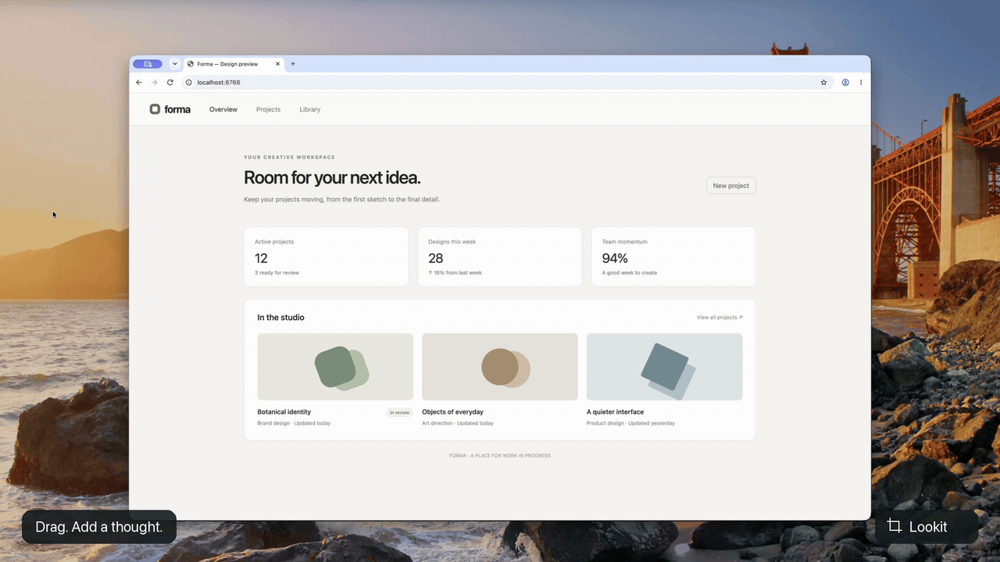

# Lookit

Three finger snapshot anything to provide a reference to your agent.

[](assets/lookit-demo.mp4)

[Watch the 29-second demo in full quality](assets/lookit-demo.mp4).

## Install

Paste into a new chat:

```
Install Lookit by running this skill: https://raw.githubusercontent.com/nadirabid/lookit/main/skills/install-lookit/SKILL.md
```

## Privacy

Lookit collects nothing, runs only on your machine, and has no improvement telemetry. It's a tiny & fast codebase — have your agent verify!
